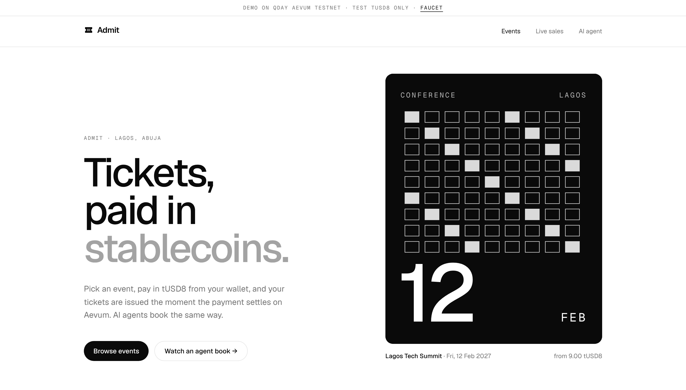

# Admit: an Aevify demo ticket platform

**Event tickets paid in tUSD8 on QDay Aevum, by people and by AI agents, built on nothing but
[Aevify](https://aevify.vercel.app)'s npm packages.**



| | |
|---|---|
| **Live demo** | https://YOUR-STORE.vercel.app |
| **Payments** | [Aevify](https://aevify.vercel.app) ([docs](https://aevify.vercel.app/docs)) |
| **Packages used** | `@aevify/node` (server), `@aevify/react` (Pay button and modal) |
| **Network** | QDay Aevum Testnet (chain ID 44005), tUSD8 |

> Testnet only. tUSD8 and tQDAY are test tokens with no value.

Admit is the example integration for Aevify: a small but complete ticket platform that shows
what a merchant actually builds. Clone it, add your Aevify keys, and you have a working
stablecoin box office.

## What it shows

- **People** pick an event, choose a ticket type and quantity, and click **Pay**. Aevify's
  checkout opens in a modal (a full-page redirect on phones). They connect a wallet and pay,
  with no addresses or typed amounts.
- **Tickets are issued from webhooks.** An order turns *Paid* and its tickets appear only
  when Aevify's signed `payment.paid` webhook arrives, never because the browser said so.
  Refunds made in the Aevify dashboard come back as `payment.refunded` and void the tickets.
- **An AI agent** with its own wallet books conference passes for a team:
  1. It reads the ticket list and checks its spending policy.
  2. It places an order that only its wallet can pay.
  3. It verifies Aevify's checkout data and pays the contract on Aevum by itself.
  4. Above its limits, it stops and asks a human.
- **A live sales feed** shows orders from people and agents as they're paid.

## How it uses Aevify

**1. Create a payment on the server** (`src/lib/orders.ts`). Prices come from Admit's own
ticket list, never from the browser:

```ts
const payment = await aevify.payments.create(
  { amount: "12.00", orderId: order.id, successUrl, cancelUrl, metadata: { orderNumber } },
  { idempotencyKey: order.id }, // a retried request can't create a second payment
);
```

**2. Open the checkout** (`src/app/events/[id]/buy-panel.tsx`):

```tsx
<AevifyButton
  publishableKey={publishableKey}
  baseUrl="https://aevify.vercel.app"
  createPayment={createPayment} // POST /api/orders, returns the payment ID
  onSuccess={() => router.push(`/orders/${orderId}`)}
/>
```

**3. Issue tickets from the signed webhook** (`src/app/api/aevify/webhook/route.ts`):

```ts
const event = await aevify.webhooks.constructEvent(rawBody, request.headers.get("aevify-signature"), process.env.AEVIFY_WEBHOOK_SECRET);
if (event.type === "payment.paid") issueTickets(event.data.object.orderId);
```

Duplicate deliveries are harmless: event IDs are remembered and updates only move forward. If
a webhook is late, a pending order also checks with Aevify's API after a few seconds, as a
backup.

**4. Agent orders are locked to the agent's wallet** with `payer`, so nobody else can pay
them.

## The AI agent

`src/lib/agent/agent.ts` runs in two places:

- **The `/agent` page** streams each step as it happens. The agent's key stays on the server.
- **Your terminal:** `npm run agent` (or `npm run agent -- team-passes`).

Before signing anything, the agent checks:

| Check | Why |
|---|---|
| Per-order limit (10 tUSD8) and daily budget (25 tUSD8) | Above either, it stops and asks a human |
| The amount matches the listed price | The platform can't overcharge it |
| The merchant is verified on Aevum | It only pays real, registered merchants |
| The network is Aevum and the token is tUSD8 | No surprise chains or tokens |
| The payment is locked to its own wallet | Nobody else can pay or redirect it |
| The approval is for the checkout contract, for this amount only | Never an unlimited approval |
| The payment isn't about to expire | No wasted gas |

The demo shows three outcomes:
- **One pass** (9.00): within policy, so it pays.
- **Three passes** (27.00): over the per-order limit, so it asks a human.
- **A third pass in one day:** over the daily budget, so it stops.

## Run it locally

You need Docker. Everything runs in containers, including a local MongoDB.

```bash
cp .env.example .env        # add your Aevify keys (see below)
docker compose up           # http://localhost:3001
```

Without Docker: `npm install && npm run dev`, with `STORE_TEST_MODE=memory` to skip MongoDB.

### Set up Admit in Aevify

In the [Aevify dashboard](https://aevify.vercel.app/dashboard), sign in and:

1. **Create the business** "Admit", then **Settings → Connect wallet** for the payout wallet.
2. **Developers → Create secret key**, and put it in `AEVIFY_SECRET_KEY`.
3. Copy the **publishable key** into `AEVIFY_PUBLISHABLE_KEY`.
4. Copy the **webhook signing secret** into `AEVIFY_WEBHOOK_SECRET`.
5. **Webhooks → Endpoint URL:** `https://YOUR-STORE.vercel.app/api/aevify/webhook`.
6. **Allowed domains:** add `https://YOUR-STORE.vercel.app` so the checkout modal can open. For
   local development against the live Aevify, also add `http://localhost:3001`.

Then open `/api/health`: every check should be `ok` or `true`.

### The agent's wallet

The agent needs its own testnet wallet, never one with real funds:
1. Create a new account in MetaMask, export its private key, and set `AGENT_PRIVATE_KEY`.
2. Send it some tUSD8 and a little tQDAY from the [faucet](https://faucet.qday.info/en).

## Deploy to Vercel

1. Push this repo to GitHub, then **Vercel → Add New → Project** and import it. The defaults
   work: Next.js, root directory `./`.
2. Add the environment variables from `.env.example`:
   - `AEVIFY_BASE_URL`, `AEVIFY_SECRET_KEY`, `AEVIFY_PUBLISHABLE_KEY` and `AEVIFY_WEBHOOK_SECRET`.
   - `MONGODB_URI`: your Atlas URI. It can be the same cluster as Aevify; Admit uses its own
     `admit_tickets` database.
   - `STORE_URL`: the store's Vercel URL.
   - `AGENT_PRIVATE_KEY`, for the live agent page.
3. Deploy, then finish the Aevify setup above: the webhook URL and the allowed domain.
4. In Aevify's dashboard, click **Developers → Send test event**. The delivery log should
   show `200` from Admit.

The production Docker image is in `Dockerfile`:
`docker compose --profile prod up store-prod` serves it on http://localhost:3002.

## The Aevify packages

Admit installs Aevify's SDKs from npm, exactly like any merchant would:

```bash
npm install @aevify/node @aevify/react
```

- [`@aevify/node`](https://www.npmjs.com/package/@aevify/node): create payments, verify webhooks (server).
- [`@aevify/react`](https://www.npmjs.com/package/@aevify/react): the Pay button and checkout modal (browser).

## Tests

```bash
npm test                          # unit tests: pricing, webhooks, refunds, agent policy and checks
python3 test-browser/store_e2e.py # end to end, see test-browser/README.md
```

The end-to-end test runs a real Aevify app and a local chain:
- **Merchant setup:** it creates the Admit merchant.
- **Customer:** it buys two tickets through the modal with a test wallet and checks they're
  issued.
- **Agent:** it runs the agent through all three outcomes.
- **Pages:** it checks the sales feed, that forged webhooks are rejected, and that every page
  fits a phone.

## Project layout

```
src/
├── app/
│   ├── page.tsx                  Events
│   ├── events/[id]/              Event page: ticket types, quantity, Aevify Pay button
│   ├── orders/                   Live sales feed, and tickets + receipt per order
│   ├── agent/                    Live AI agent page
│   └── api/
│       ├── tickets/              Public ticket list (agents read this)
│       ├── orders/               Create orders + Aevify payments, read status
│       ├── aevify/webhook/       Signed Aevify webhooks
│       ├── agent/                Agent status and streamed runs
│       └── health/               Configuration check
├── components/poster.tsx         Black-and-white event posters (SVG)
├── lib/
│   ├── events.ts                 Events and ticket types
│   ├── orders.ts                 Orders <-> Aevify payments
│   ├── agent/agent.ts            The AI agent (policy, checks, paying on Aevum)
│   └── db.ts                     MongoDB (or in-memory for tests)
scripts/agent.ts                  Run the agent from a terminal
```

## License

MIT. Built with Next.js, React, Tailwind CSS, viem, MongoDB, zod, the Geist fonts (OFL), and
Aevify's `@aevify/node` and `@aevify/react` (MIT).
